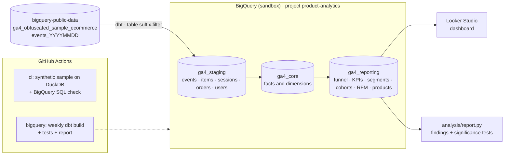

# E-commerce Product Analytics on BigQuery (GA4)

[](https://github.com/vitorchavernue/ecommerce-product-analytics-bigquery/actions/workflows/ci.yml)
[](https://github.com/vitorchavernue/ecommerce-product-analytics-bigquery/actions/workflows/bigquery.yml)

Product and marketing analytics for an online store, built on the **real Google Analytics 4 export** of the
Google Merchandise Store (public BigQuery dataset, Nov 2020 – Jan 2021):

- **BigQuery** as the warehouse, reading the raw GA4 export (nested events, one table per day)
- **dbt** turning raw events into sessions, orders, users and products, with **data quality tests** on every run
- **Advanced SQL analytics**: purchase funnel, conversion by segment with **confidence intervals and significance
  tests**, weekly **cohort retention**, **RFM customer segmentation** and product performance
- **Looker Studio** dashboard on top of the reporting tables
- **CI** running the whole project on a synthetic GA4-shaped sample (DuckDB) at every push, plus a **weekly
  scheduled run on BigQuery** — all on the free BigQuery sandbox (no credit card)

---

## 🎯 Business problem

The store has millions of tracking events, but the marketing and product teams cannot answer basic questions with
confidence:

| Question | Why it is hard with the raw data |
|---|---|
| **Where do visitors give up** on the way to a purchase? | GA4 stores events, not visits or funnels: each event is a row with its details hidden in nested lists |
| **Which channels and devices really convert better?** | Rates are compared without considering sample size, so a channel with a lucky week looks like a winner |
| **Do new customers come back?** | Retention needs users grouped by first visit and followed week by week |
| **Who are the best customers, and who is about to leave?** | There is no customer view: only anonymous identifiers and purchase events |
| **Which products attract interest but do not sell?** | Product data is nested inside each event, mixed with views, cart and checkout steps |
| **Are the numbers right?** | The export has duplicated purchase events and purchases without a transaction id: summing raw events inflates revenue |

## 💡 Solution

| Layer | What was built | Problem solved |
|---|---|---|
| **Staging** | Flattened events (`stg_ga4__events`) and products (`stg_ga4__items`) with readable, typed columns | The public dataset is scanned once per run; every other model reads small tables |
| **Intermediate** | Orders deduplicated by transaction id, visits rebuilt from events, users with acquisition channel | Correct revenue and a real notion of *visit* and *customer* |
| **Core marts** | `fct_sessions`, `fct_orders`, `fct_order_items`, `dim_users`, `dim_items` | One tested source of truth for any analysis |
| **Reporting marts** | Funnel, daily KPIs, segment conversion with statistics, cohort retention, RFM, product performance | Flat tables ready for Looker Studio |
| **Data quality** | 40+ dbt tests: keys, accepted values, relationships, funnel consistency, revenue reconciliation with the raw events | Wrong numbers never reach the dashboard |
| **Automation** | GitHub Actions: CI on a synthetic sample + weekly production run on BigQuery | Reproducible, and the sandbox tables (60-day expiry) are renewed automatically |

## 📈 Results

Key findings from the real data are in **[docs/findings.md](docs/findings.md)**, generated by
[`analysis/report.py`](analysis/report.py) from the BigQuery tables at every production run.

---

## 🏗️ Architecture



### dbt models

| Layer | Model | Grain | Purpose |
|---|---|---|---|
| Staging | `stg_ga4__events` | event | Nested GA4 fields flattened (session id, page, source, device, geo, revenue) |
| Staging | `stg_ga4__items` | product in event | One row per product in view / cart / checkout / purchase events |
| Intermediate | `int_orders` | order | Purchases deduplicated by transaction id |
| Intermediate | `int_sessions` | visit | Events grouped into visits: source, landing page, engagement, funnel steps, revenue |
| Intermediate | `int_users` | user | First touch, acquisition channel, lifetime totals |
| Core | `fct_sessions` | visit | Open and **closed** funnel flags, channel, device, visitor type |
| Core | `fct_orders`, `fct_order_items` | order / product | Orders with visit context; products sold |
| Core | `dim_users`, `dim_items` | user / product | Dimensions |
| Reporting | `rpt_daily_kpis` | day × channel × device × visitor type × country | Additive KPIs for scorecards and trends |
| Reporting | `rpt_funnel` | day × segment × step | Closed funnel in long format |
| Reporting | `rpt_segment_conversion` | segment | Conversion, **95% Wilson interval**, **two-proportion z test** vs the rest of the store |
| Reporting | `rpt_cohort_retention` | cohort week × week number | Weekly retention of new users |
| Reporting | `rpt_rfm_customers`, `rpt_rfm_segments` | customer / segment | Recency, frequency, monetary scores and segments |
| Reporting | `rpt_product_performance` | product | Views, cart rate, purchase rate, revenue |

---

## 🔬 Analytical methods

| Analysis | Method | Business reading |
|---|---|---|
| **Funnel** | Closed funnel per visit (a step counts only if all previous steps happened) | Drop-off between steps, never inflated by tracking gaps |
| **Segment conversion** | Wilson 95% interval + two-proportion z test (segment vs rest), in SQL | Separates real differences from noise in small segments |
| **Holiday effect / device gap** | Two-proportion tests with p-values (`analysis/stats.py`) | "Is the difference significant?" answered with a number |
| **Retention** | Weekly cohorts of new users, incomplete weeks flagged | Whether acquisition brings customers back |
| **RFM** | Recency and monetary quintiles, frequency by order count, rule-based segments | Which customers to reward, nurture or win back |
| **Product performance** | Session-based cart rate and purchase rate per product | Products with interest but weak conversion |

## ✅ Data quality

`dbt build` runs every model and test; any failure stops the run:

- **Keys**: unique / not null on sessions, orders, users, products, RFM customers
- **Relationships**: orders and visits → users; order items → orders
- **Accepted values**: devices, channels, visitor types, funnel steps, RFM segments
- **Business rules**:
  - closed funnel never increases from one step to the next
  - order revenue reconciles with the raw purchase events, one per transaction (1 cent tolerance)
  - no visit lost when events are grouped into sessions
  - retention between 0% and 100%, and exactly 100% in week 0
  - the confidence interval always contains the measured rate

## 💰 Cost and BigQuery sandbox decisions

The project runs on the **BigQuery sandbox** (free, no credit card: 1 TB of queries per month, 10 GB of storage,
tables expire after 60 days, no DML):

- **Table suffix filter** (`_table_suffix between ...`): only the days of the analysis window are scanned and billed
- **Raw data read once**: staging tables are materialized; every other model reads them instead of the public dataset
- **Cost guardrail**: `maximum_bytes_billed` (20 GB) in the dbt profile — a query that would scan more fails instead of billing
- **No partitioning by event date**: in the sandbox, partitions older than 60 days expire immediately, and the sample is from
  2020–2021; tables are **clustered** instead
- **Only `CREATE OR REPLACE` (no MERGE / UPDATE)**: full rebuilds, compatible with the sandbox's no-DML rule
- **Weekly scheduled run**: rebuilds every table, renewing the 60-day expiry so the dashboard is always available

## 🚀 How to run

**Locally (no Google account):** synthetic sample with the same structure as GA4 → dbt on DuckDB → tests → report

```bash
pip install -r requirements.txt
make all          # lint, unit tests, sample data, dbt build, BigQuery SQL check, findings report
```

**On BigQuery (real data):**

```bash
export GCP_PROJECT_ID=<your-project-id>
gcloud auth application-default login     # or GOOGLE_APPLICATION_CREDENTIALS=<service account key>
make bigquery bigquery-report             # dbt build on BigQuery + docs/findings.md
```

**GitHub Actions:** add the repository secrets `GCP_SA_KEY` (service account with *BigQuery Data Editor* and
*BigQuery Job User*) and `GCP_PROJECT_ID`; the `bigquery` workflow runs weekly, on changes to the dbt project, or on demand.

## 📁 Repository structure

```
├── dbt/
│   ├── models/staging/          # flattened GA4 events and products
│   ├── models/intermediate/     # orders (deduplicated), sessions, users
│   ├── models/marts/core/       # facts and dimensions
│   ├── models/marts/reporting/  # Looker Studio tables (funnel, KPIs, segments, cohorts, RFM, products)
│   ├── macros/                  # BigQuery / DuckDB helpers, channel grouping, Wilson interval, z test
│   └── tests/                   # business-rule tests
├── analysis/                    # findings report and statistics
├── scripts/                     # synthetic GA4 sample generator, BigQuery SQL checker
├── tests/                       # unit tests
├── docs/                        # findings and dashboard
└── .github/workflows/           # ci (DuckDB) and bigquery (production, weekly)
```

## 🛠️ Tech stack

**BigQuery** · **dbt** (BigQuery and DuckDB adapters) · **SQL** (nested data, window functions, statistics) ·
**Python** (pandas, SciPy) · **Looker Studio** · **GitHub Actions**

**Data source:** [Google Analytics 4 sample ecommerce dataset](https://developers.google.com/analytics/bigquery/web-ecommerce-demo-dataset)
(`bigquery-public-data.ga4_obfuscated_sample_ecommerce`), Google Merchandise Store. Some values are obfuscated by Google
(`<Other>`, `(data deleted)`) and are reported as *Unattributed* instead of being guessed.
